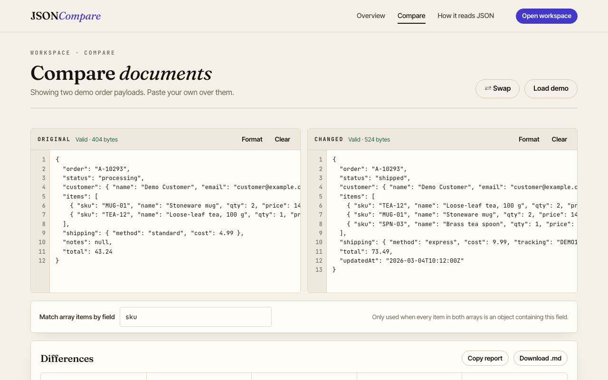
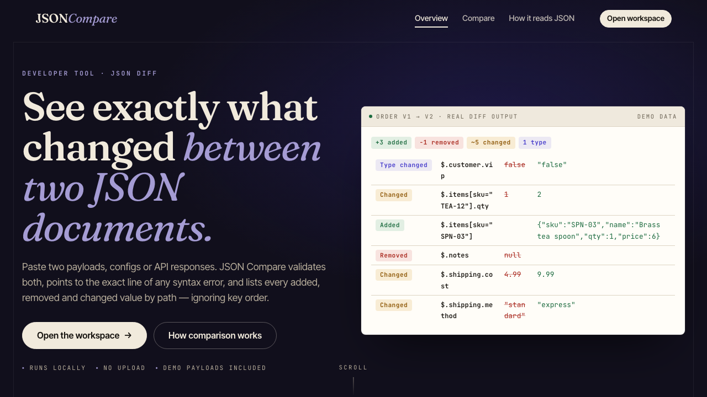
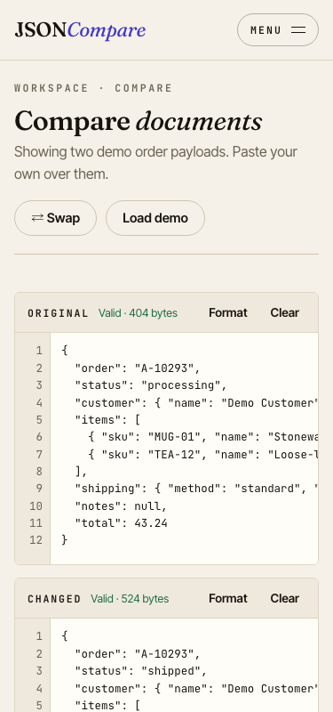

# JSON Compare

A split-pane workspace for comparing two JSON documents. Both sides are validated with line-and-column errors, and every difference is listed by JSON path — added, removed, changed, or type changed — with key order ignored.



| Landing | Mobile |
| --- | --- |
|  |  |

## Run it

```bash
npm install
npm run dev        # http://localhost:5111
npm test
npm run build
npm run test:e2e   # Playwright smoke test (npm run e2e:install once if Chromium is missing)
```

## Main workflow

1. **Compare** opens with two labelled demo order payloads (v1 → v2) and array matching by `sku`, showing 10 differences.
2. Paste your own documents. Each pane shows Valid/Invalid and size; errors show “Line 3, column 1: …” with a plain-English hint and the line marked in the gutter.
3. The comparison runs automatically after a short pause (a “Comparing…” state is shown while pending).
4. Read the stat tiles, filter by kind or path, page through results (25 per page), and **Copy report** / **Download .md**.
5. Optional: **Match array items by field** (e.g. `id`) to compare list items regardless of position. **Format**, **Clear**, **Swap** and **Load demo** are available.

States: empty (nothing to compare), invalid input, identical documents, filtered-to-nothing, success (report copied), error (clipboard blocked).

## How it compares

See the in-app **How it reads JSON** page. In short: object key order and formatting are ignored; arrays are compared by index unless matched by a field; type changes are separate from value changes; paths use `$`, dot notation and quoted keys.

## Tests

- `src/lib/diff.test.ts` — parse errors with line/column and hints, added/removed/changed/type detection, key order, index vs keyed arrays, quoted paths, identical docs, structure stats, Markdown export.
- `src/App.test.tsx` — demo comparison, syntax error reporting, filters, identical and empty states.
- `e2e/smoke.spec.ts` — invalid → valid input, live recompare, Format, demo, filter, reload persistence; strict 375px checks.

## Limitations

- Numbers beyond 2^53 lose precision (standard `JSON.parse`).
- No inline side-by-side highlighting inside the editors; differences are listed in a table.
- Very large files are processed on the main thread.
- JSON only — no comments, trailing commas (JSON5) or YAML.

## Future improvements

- Inline highlighting of changed lines, a Web Worker for multi-MB files, and JSON5/YAML input.
